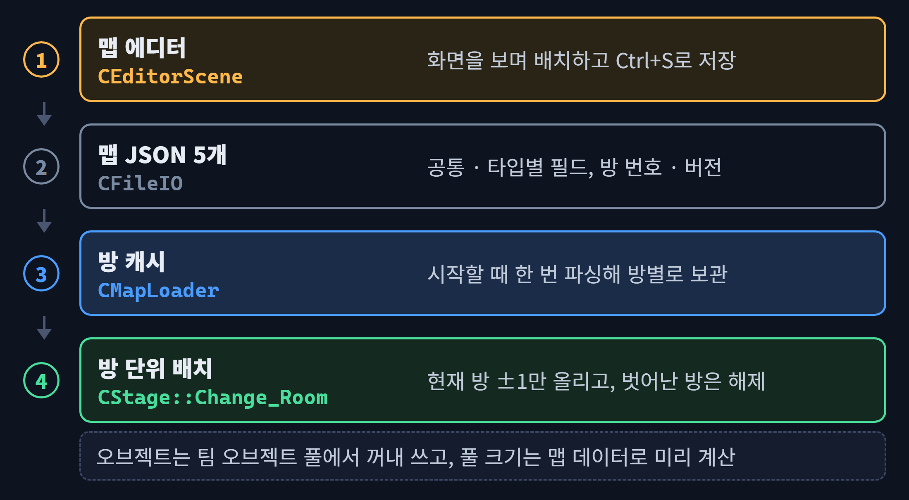
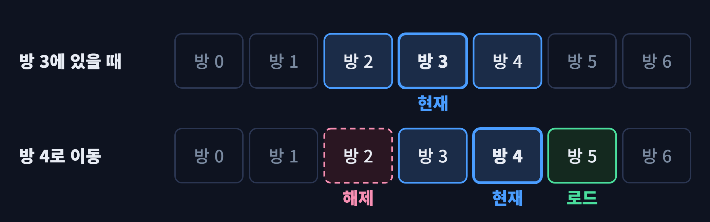
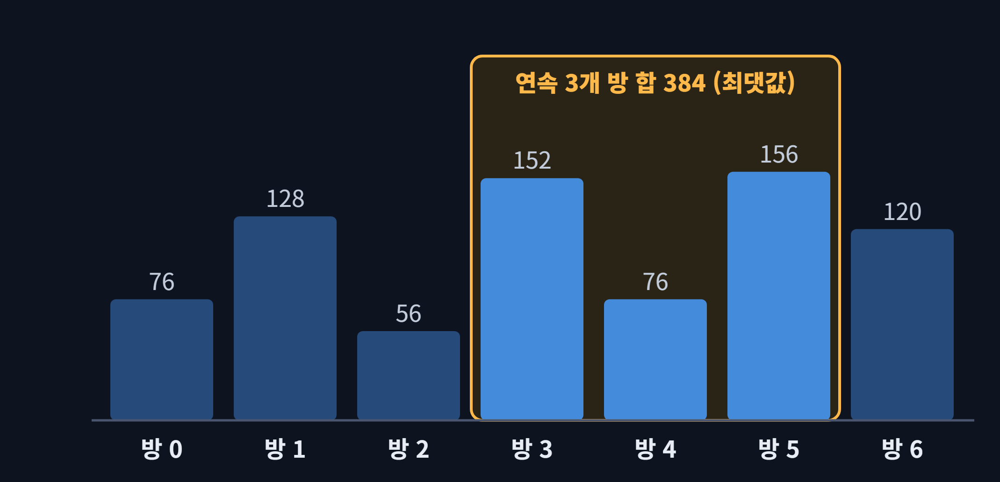
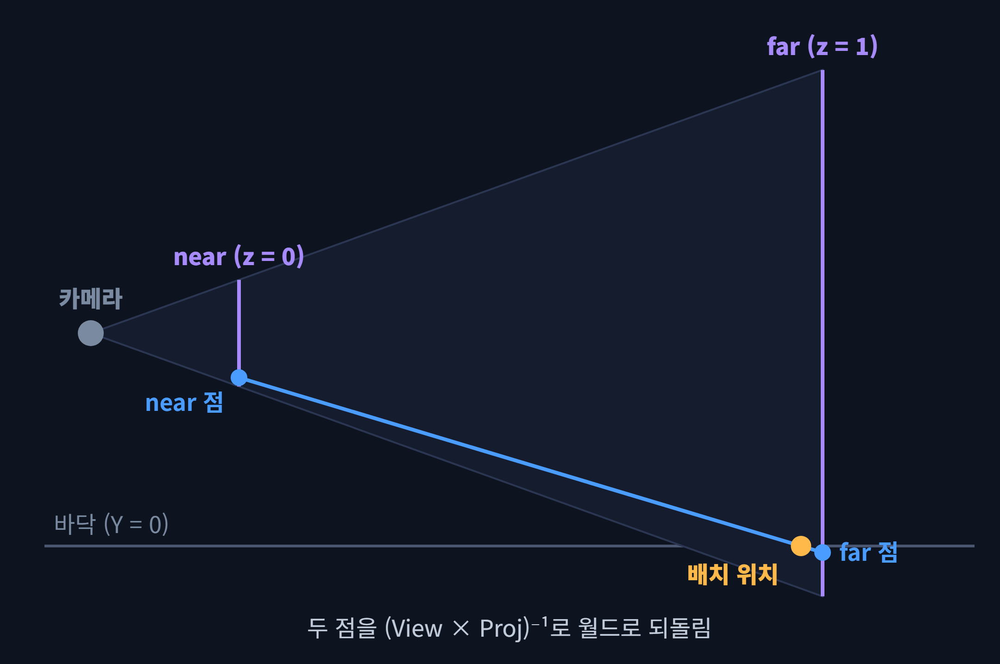
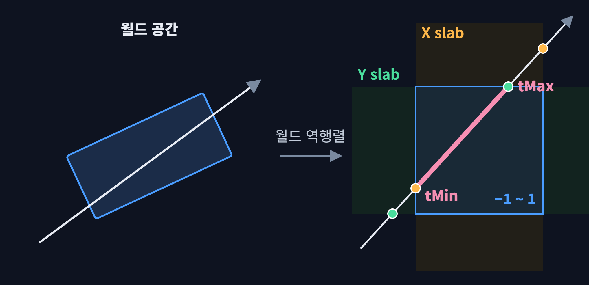
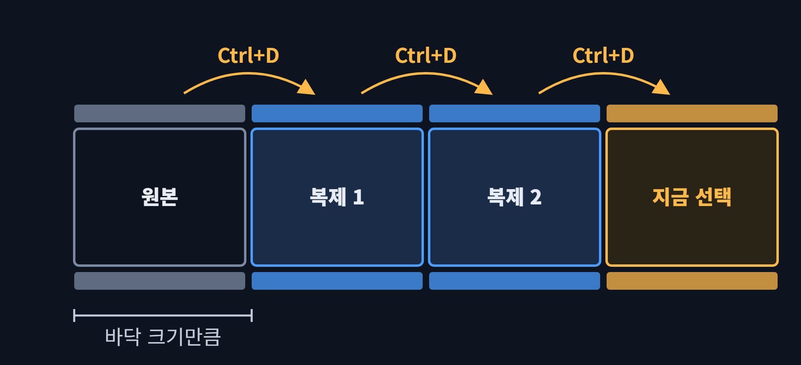
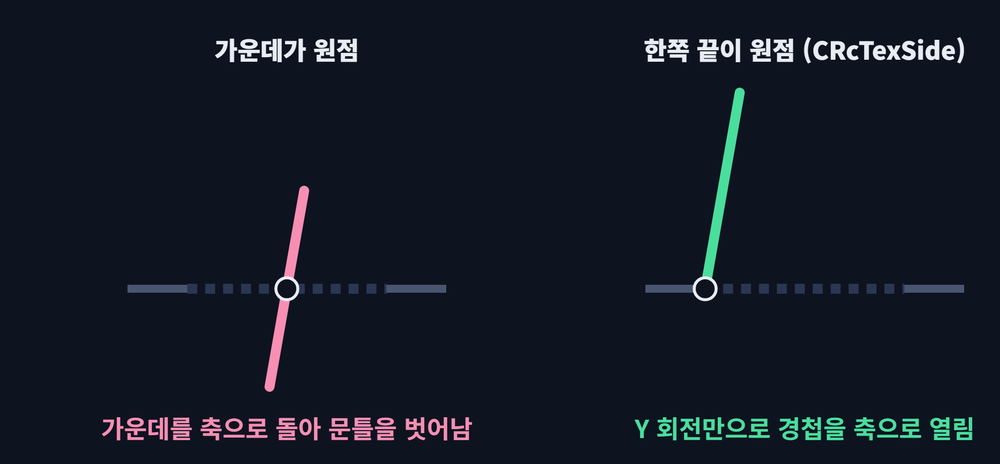
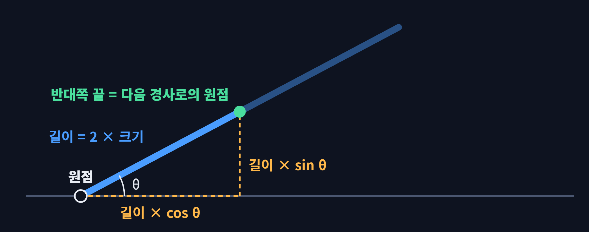
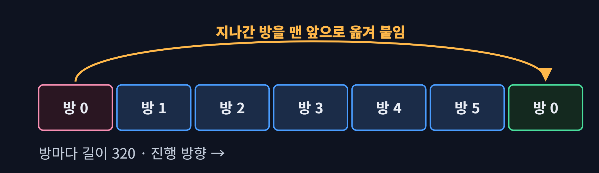

# DX9_2.5D_GameProject

**DirectX 9 기반 2.5D 액션 — 「MULLET MADJACK」 모작 (3인 팀 프로젝트)**

[개요](#개요) · [하이라이트](#하이라이트) · [내 담당](#내-담당) · [주요 구현](#주요-구현) · [기술 스택](#기술-스택)

---

## 개요

DirectX 9 기반의 자체 엔진 프레임워크를 활용해 만든 「MULLET MADJACK」 모작입니다.

| | |
| --- | --- |
| 기간 | 2025.12.20 ~ 2026.02.03 (약 6주) |
| 인원 | 3인 |
| 규모 | 맵 5종 · 배치 오브젝트 12,391개 · 에디터 오브젝트 16종 |
| 플레이 영상 | [YouTube](https://www.youtube.com/watch?v=mse-dFJAwSs) |

| 팀원 | 담당 |
| --- | --- |
| [inthekg](https://github.com/inthekg) | 팀장 · 프레임워크 · 몬스터 |
| [ChanWooKang](https://github.com/ChanWooKang) | 플레이어 · UI |
| **[ddoichaboom](https://github.com/ddoichaboom)** | **맵 파이프라인 · 맵 에디터 · 맵 오브젝트 · 레벨 디자인** |

---

## 하이라이트

<table>
  <tr>
    <td width="50%"><br/><sub><b>튜토리얼</b></sub></td>
    <td width="50%"><br/><sub><b>일반 맵</b></sub></td>
  </tr>
  <tr>
    <td><br/><sub><b>스나이퍼 맵</b></sub></td>
    <td><br/><sub><b>자동차 맵</b></sub></td>
  </tr>
</table>

---

## 내 담당

#### □ 맵 파이프라인
- 맵 JSON 포맷 설계, 에디터 저장(`CFileIO`) · 게임 맵 로더(`CMapLoader`)

#### □ 방 단위 스트리밍
- 현재 방 ±1 로드 · 해제, 맵 데이터로 오브젝트 풀 크기 산정

#### □ 맵 에디터
- ImGui 맵 에디터 · 에디터 오브젝트 16종 · 레이 피킹 · 방향 복제

#### □ 지형 · 맵 오브젝트
- 지형 상속 구조 · 문 · 경사로 · 맵 콜라이더

#### □ 레벨 디자인
- 맵 5종 (튜토리얼 · 일반 · 스나이퍼 · 보스 · 자동차), 무한 도로 맵 데이터

> 플레이어 · 무기 · 몬스터 · 보스 · UI · 이펙트는 팀원 작업입니다.

---

## 주요 구현

[1. 맵 파이프라인](#1-맵-파이프라인) · [2. 방 단위 스트리밍 · 오브젝트 풀](#2-방-단위-스트리밍--오브젝트-풀) · [3. 맵 에디터 (ImGui)](#3-맵-에디터-imgui)<br/>
[4. 지형 · 맵 오브젝트](#4-지형--맵-오브젝트) · [5. 레벨 디자인](#5-레벨-디자인)

## 1. 맵 파이프라인

맵 5종 · 오브젝트 1만 개 이상을 코드에 좌표로 적을 수는 없었습니다.<br/>
그래서 **에디터에서 만든 맵을 JSON으로 저장하고, 게임은 이 파일을 읽어 배치**하게 했습니다.

<p align="center">
  
</p>

### ■ 에디터와 게임의 분리

에디터와 게임은 같은 엔진 위의 별도 실행 파일이고, 둘 사이의 계약은 JSON 파일 하나입니다.

<details>
<summary><b>세부 구현 사항</b></summary>

- 에디터는 게임 로직 없이, 배치에 필요한 정보만 가진 전용 오브젝트 16종을 씀
- 맵을 고쳐도 게임을 다시 빌드하지 않음

</details>

### ■ JSON 맵 포맷

에디터의 `CFileIO`가 오브젝트마다 공통 필드와 타입별 필드를 기록합니다.

```json
{ "type": "Floor", "roomIndex": 1, "position": [-48, 64, 416], "rotation": [90, 0, 0],
  "scale": [8, 8, 1], "floorType": 0, "textureIdx": 5 }
{ "type": "Door",  "roomIndex": 1, "doorID": 2, "doorType": 0, "position": [24, 16, 216], ... }
{ "type": "MapCollider", "roomIndex": 0, "colliderTag": 0, "scale": [32, 16, 48], ... }
```

<details>
<summary><b>세부 구현 사항</b></summary>

#### □ 필드 구성
- 공통 필드
  - 타입 · 방 번호 · 위치 · 회전 · 크기
- 타입별 필드
  - 바닥 종류 · 텍스처 칸, 문 ID, 콜라이더 태그처럼 타입마다 필요한 것만 기록
- 들여쓰기 저장
  - 사람이 읽을 수 있고, 맵 수정 내역을 Git diff로 비교할 수 있음

#### □ 방 번호 규약
- 방 단위로 불러오려고, 모든 오브젝트에 방 번호를 두기로 팀과 정함
- 게임 오브젝트의 방 번호 필드는 팀장이 추가
- 에디터 저장 → JSON → 로더 배치까지 방 번호가 이어지게 연결

#### □ 버전 필드
- 파일마다 `version`을 기록해, 포맷이 바뀐 뒤 옛 파일을 잘못 읽지 않게 함
- 게임은 방 번호가 추가된 버전 4 미만을 거부하고, 에디터는 이전 버전도 기본값으로 읽음
- 저장 · 로드는 `json::exception`을 잡아 오류 메시지로 알림

```cpp
jMap["version"] = FILE_VERSION;
for (auto& pObj : objectList)
{
    json jObj;
    jObj["type"] = "Floor";                    // DynamicFloor · SlopeFloor 등 타입별 분기
    jObj["roomIndex"] = pObj->Get_RoomIndex();
    SaveTransformData(jObj, pObj);             // position · rotation · scale
    SaveTextureData(jObj, pObj);               // floorType · textureIdx
    jObjects.push_back(jObj);
}
file << jMap.dump(2);                          // 들여쓰기 2칸
```

<sub>코드 · [`CFileIO::Save_MapData`](https://github.com/ddoichaboom/DX9_2.5D_GameProject/blob/9a49e1837a079ea5d0458322138afe79708e023a/Editor/Code/CFileIO.cpp#L126-L419)</sub>

</details>

### ■ 맵 로더 · 방 캐시

플레이 중에 파일을 다시 읽지 않도록, 게임은 시작할 때 맵 5개를 한 번만 읽어 캐시합니다.

<details>
<summary><b>세부 구현 사항</b></summary>

- `map<string, map<int, RoomData>>`(파일 이름 → 방 번호 → 방 데이터)로 보관
- 방 데이터에는 오브젝트 목록과 타입별 개수를 함께 저장해, 풀 크기 계산에 그대로 씀
- 방 번호가 없는 오브젝트는 0번 방으로 넣음
- 방 번호 순으로 순회되는 `map<int, …>`라, 연속한 방 계산이 간단함

```cpp
_uint iVersion = jMap["version"];
if (iVersion < 4)                                            // 방 번호가 없는 옛 포맷
    return E_FAIL;
map<int, RoomData>& roomMap = m_mapAllRooms[strFileName];   // 경로에서 파일 이름만
for (auto& jObj : jObjects)
{
    _int iRoomIndex = 0;
    if (jObj.contains("roomIndex"))                          // 없으면 0번 방
        iRoomIndex = jObj["roomIndex"];
    ObjectData objData = Parse_ObjectData_FromJSON(jObj);
    roomMap[iRoomIndex].vObjects.push_back(objData);
    // ... 타입별 개수 (iFloorCount++ 등)
}
```

<sub>코드 · [`CMapLoader::Preload_AllMapData`](https://github.com/ddoichaboom/DX9_2.5D_GameProject/blob/9a49e1837a079ea5d0458322138afe79708e023a/Client/Code/CMapLoader.cpp#L85-L192)</sub>

</details>

<br/>

## 2. 방 단위 스트리밍 · 오브젝트 풀

### ■ 방 단위 스트리밍

튜토리얼 · 일반 맵은 방 5 ~ 7개, 오브젝트 1,500 ~ 3,200개입니다.<br/>
플레이어 주변만 있으면 되므로 **현재 방 ±1개만 올려 두고**, 벗어난 방은 풀에 반납합니다.<br/>
그래서 매 프레임 갱신 · 렌더되는 오브젝트가 맵 전체가 아니라 주변 방 몫으로 줄어듭니다.

<p align="center">
  
</p>

<details>
<summary><b>세부 구현 사항</b></summary>

- 방 이동 트리거가 팀 이벤트를 보내면 `Change_Room(현재 방 + 1)`을 호출
- 로드된 방 목록(`set<int>`)과 새 방 ±1을 비교해 해제할 방과 로드할 방을 구함
- 이미 올라가 있는 방은 다시 로드하지 않음

```cpp
// CStage::Change_Room
for (_int iLoadedRoom : m_setLoadedRooms)                   // 범위 밖 방은 해제
    if (iLoadedRoom < iNewRoomIndex - 1 || iLoadedRoom > iNewRoomIndex + 1)
        roomsToUnload.insert(iLoadedRoom);
for (_int i = iNewRoomIndex - 1; i <= iNewRoomIndex + 1; ++i)   // 범위 안인데 없는 방은 로드
    if (i >= 0 && m_setLoadedRooms.find(i) == m_setLoadedRooms.end())
        roomsToLoad.insert(i);

// CMapLoader::Get_GameObject_FromPool — 풀에서 꺼내 캐시 데이터로 다시 세팅
CFloor* pFloor = Engine::CPoolMgr::GetInstance()->Get_Object<CFloor>();
pFloor->SetPos(objData.vPos);  pFloor->SetAngle(objData.vRot);  pFloor->SetScale(objData.vScale);
pFloor->Set_TextureIdx(objData.iTextureIdx);
pFloor->Set_FloorType(objData.iFloorType);
pFloor->Get_Component(ID_STATIC, L"Com_Transform")->Update_Component(0.f);   // 월드 행렬 1회
```

<sub>코드 · [`CStage::Change_Room`](https://github.com/ddoichaboom/DX9_2.5D_GameProject/blob/9a49e1837a079ea5d0458322138afe79708e023a/Client/Code/CStage.cpp#L39-L123) · [`CMapLoader::Get_GameObject_FromPool`](https://github.com/ddoichaboom/DX9_2.5D_GameProject/blob/9a49e1837a079ea5d0458322138afe79708e023a/Client/Code/CMapLoader.cpp#L783-L1043)</sub>

</details>

#### □ 방 로드 · 해제

문을 지나면 다음 방이 이미 올라와 있고, ±1 범위를 벗어난 방은 풀로 돌아갑니다.

<table>
  <tr>
    <td width="50%"><br/><sub><b>방 로드</b></sub></td>
    <td width="50%"><br/><sub><b>방 해제</b></sub></td>
  </tr>
</table>

<details>
<summary><b>세부 구현 사항</b></summary>

- 로드
  - 캐시된 방 데이터를 돌며 타입별 풀에서 오브젝트를 꺼내 위치 · 텍스처 · 타입을 세팅
  - 지형은 꺼낼 때 월드 행렬을 한 번 계산하고, 레이어(지형 · 게임 로직)에 추가
- 해제
  - 순회 중인 레이어에서 바로 지우지 않고 `SetDead`로 표시만 함
  - 레이어가 제거하면서 풀에 반납하고, 플레이어 · 카메라는 제외
- 스테이지 전환
  - 로드된 방을 모두 해제한 뒤, 다음 맵의 0 · 1번 방을 로드

</details>

#### □ 동시 로드 최대치

맵 데이터로 계산한, 동시에 올라가 갱신 · 렌더되는 오브젝트의 최대치입니다.<br/>
방이 하나인 스나이퍼 · 보스 맵은 전체를 한 번에 올립니다.

| 맵 (방 수) | 전체 오브젝트 | 동시에 올라가는 최대 |
| --- | ---: | ---: |
| 튜토리얼 (5) | 1,508 | 1,052 (70%) |
| 일반 맵 (7) | 3,221 | 2,147 (67%) |
| 자동차 맵 (6) | 595 | 318 (53%) |

### ■ 오브젝트 풀 크기 산정

풀이 모자라면 오브젝트가 나오지 않고, 너무 크면 메모리가 낭비됩니다.<br/>
그래서 **맵 데이터로 필요한 최대치를 계산**해 풀 크기를 정했습니다.<br/>
아래는 일반 맵의 방별 바닥 개수로 본 예시입니다.

<p align="center">
  
</p>

<details>
<summary><b>세부 구현 사항</b></summary>

- 동시에 올라가는 방은 연속 3개
- 맵 파일마다 연속한 방 3개의 합 중 최댓값을 타입별로 구함
- 모든 맵 파일 중 최댓값을 타입별 풀 크기로 쓰고, 문짝은 문과 같은 개수로 둠
- 결과
  - 바닥 3,455 · 벽 1,147 · 진열 큐브 746 · 천장 416 · 진열물 152 · 창문 120 · 흐르는 바닥 104
  - 바닥 · 벽 풀은 방이 하나라 전체를 올리는 스나이퍼 맵이 정함

```cpp
for (auto iter = roomMap.begin(); iter != roomMap.end(); ++iter)   // 시작 방을 하나씩 밀며
{
    _int iStartRoom = iter->first;
    _uint iSum = 0;
    for (_int i = 0; i < 3; ++i)                                     // 연속 3개 방의 합
    {
        auto iterTarget = roomMap.find(iStartRoom + i);
        if (iterTarget == roomMap.end())
            break;
        iSum += iterTarget->second.iFloorCount;                      // (타입별 개수)
    }
    if (iSum > iMaxCount)
        iMaxCount = iSum;
}
```

<sub>코드 · [`CMapLoader::Get_MaxObjectCount`](https://github.com/ddoichaboom/DX9_2.5D_GameProject/blob/9a49e1837a079ea5d0458322138afe79708e023a/Client/Code/CMapLoader.cpp#L562-L635)</sub>

</details>

<br/>

## 3. 맵 에디터 (ImGui)

화면을 보며 배치하고 바로 JSON으로 저장하는 ImGui 맵 에디터입니다.<br/>
배치할 양이 많아, 원하는 오브젝트를 정확히 집는 피킹과 반복 작업을 줄이는 기능에 집중했습니다.

### ■ 에디터 구성

| 클래스 | 하는 일 |
| --- | --- |
| `CEditorScene` | 입력 처리 · 오브젝트 목록 소유 |
| `CMousePicker` | 화면 좌표 → 월드 광선 |
| `CSelectionMgr` | 광선 판정 · 다중 선택 목록 |
| `CFileIO` | JSON 저장 · 로드 |
| ImGui 패널 | 툴바(선택 + 배치 17종 · 카메라 모드) · 인스펙터 · 계층 창 · 메뉴 |

#### □ 인스펙터

고른 오브젝트의 텍스처 · 타입 같은 속성을 코드 수정 없이 바로 바꿉니다.

<p align="center">
  
</p>

<details>
<summary><b>세부 구현 사항</b></summary>

- 바꿀 수 있는 속성
  - 텍스처 · 타입 · 콜라이더 태그 · 문 ID · 경사 각도 · 몬스터 종류 · 방 번호
- 선택된 오브젝트는 텍스처 색에 노란색을 곱해(TFACTOR) 표시
- ImGui 패널 위 클릭(`WantCaptureMouse`)은 씬으로 보내지 않아, 패널을 조작할 때 뒤쪽에 오브젝트가 놓이지 않음

</details>

### ■ 레이 피킹

클릭한 오브젝트는 광선 만들기 → 로컬 공간 판정 → 우선순위 정렬 순서로 고릅니다.

#### □ 화면 → 월드 광선

마우스 위치를 near · far 평면의 두 점으로 만들어, 월드 공간의 광선으로 되돌립니다.

<p align="center">
  
</p>

<details>
<summary><b>세부 구현 사항</b></summary>

- 화면 좌표를 NDC(−1 ~ 1, Y 반전)로 바꿈
- (View × Proj)⁻¹로 near · far 두 점을 월드로 되돌려 광선을 만듦
- 투영 역행렬을 곱하면 w가 1이 아니라, 원근 나눗셈까지 하는 `TransformCoord`로 변환
- 배치 모드에서는 광선과 `Y = 0` 평면의 교점에 오브젝트를 놓음
- 광선이 평면과 평행하거나 평면이 카메라 뒤에 있으면 원점에 놓음

```cpp
// CMousePicker::Screen_To_WorldRay
_float fNdcX = ((_float)ptMouse.x / (WINCX * 0.5f)) - 1.f;
_float fNdcY = -((_float)ptMouse.y / (WINCY * 0.5f)) + 1.f;  // Y축 반전
_matrix matViewProj = matView * matProj;
D3DXMatrixInverse(&matInvViewProj, nullptr, &matViewProj);
_vec3 vNear(fNdcX, fNdcY, 0.f);  // Near Plane (Z=0)
_vec3 vFar(fNdcX, fNdcY, 1.f);   // Far Plane (Z=1)
D3DXVec3TransformCoord(&vWorldNear, &vNear, &matInvViewProj);
D3DXVec3TransformCoord(&vWorldFar, &vFar, &matInvViewProj);
m_vRayPos = vWorldNear;
m_vRayDir = vWorldFar - vWorldNear;
D3DXVec3Normalize(&m_vRayDir, &m_vRayDir);

// CEditorScene::Pick_OnPlane — 광선과 Y = fPlaneY 평면의 교점
_float t = (fPlaneY - vRayPos.y) / vRayDir.y;
_vec3 vIntersection = vRayPos + vRayDir * t;
```

<sub>코드 · [`CMousePicker::Screen_To_WorldRay`](https://github.com/ddoichaboom/DX9_2.5D_GameProject/blob/9a49e1837a079ea5d0458322138afe79708e023a/Editor/Code/CMousePicker.cpp#L19-L43) · [`CEditorScene::Pick_OnPlane`](https://github.com/ddoichaboom/DX9_2.5D_GameProject/blob/9a49e1837a079ea5d0458322138afe79708e023a/Editor/Code/CEditorScene.cpp#L690-L716)</sub>

</details>

#### □ 로컬 공간 판정

오브젝트마다 크기 · 회전이 달라, 광선을 오브젝트의 로컬 공간으로 옮겨 단위 상자 하나로 판정했습니다.

<p align="center">
  
</p>

<details>
<summary><b>세부 구현 사항</b></summary>

- 월드 역행렬로 광선을 로컬로 옮김
  - 점은 `TransformCoord`(이동까지), 방향은 `TransformNormal`(회전 · 크기만)
- 로컬에서는 모든 오브젝트가 −1 ~ 1 상자라, 판정 함수 하나로 모든 종류를 처리
- 축별 진입 · 이탈 거리를 겹쳐 보는 Slab 판정으로, 겹치는 구간이 남으면 맞음
- 광선이 축과 평행하면 그 축의 slab 안에 있는지만 확인

</details>

#### □ 선택 우선순위

광선이 바닥에도 함께 맞아, 바닥 위 작은 오브젝트를 집기 어려웠습니다.<br/>
그래서 맞은 후보를 타입 우선순위, 그다음 거리 순으로 정렬해 첫 번째를 고릅니다.

| 타입 | 선택 우선순위 |
| --- | ---: |
| 스폰 포인트 | 100 |
| 자판기 | 80 |
| 벽 · 흐르는 벽 | 60 |
| 그 외(문 · 콜라이더 · 진열물 등) | 50 |
| 바닥 · 흐르는 바닥 · 경사로 · 천장 | 40 |

<details>
<summary><b>세부 구현 사항</b></summary>

```cpp
D3DXMatrixInverse(&matWorldInv, nullptr, pWorldMatrix);
D3DXVec3TransformCoord(&vLocalRayPos, &vRayPos, &matWorldInv);    // 점: 이동까지 적용
D3DXVec3TransformNormal(&vLocalRayDir, &vRayDir, &matWorldInv);   // 방향: 회전 · 크기만
D3DXVec3Normalize(&vLocalRayDir, &vLocalRayDir);
if (Intersect_RayAABB(vLocalRayPos, vLocalRayDir, vMin, vMax, &fDistance))   // −1 ~ 1 상자
{
    info.fDistance = fDistance;
    info.iPriority = GetPickingPriority(pObj);
    pickedList.push_back(info);
}
pickedList.sort([](const PickedInfo& a, const PickedInfo& b)
    {
        if (a.iPriority != b.iPriority)
            return a.iPriority > b.iPriority;   // 우선순위 높은 순
        return a.fDistance < b.fDistance;       // 거리 가까운 순
    });
```

<sub>코드 · [`CSelectionMgr::Pick_Object`](https://github.com/ddoichaboom/DX9_2.5D_GameProject/blob/9a49e1837a079ea5d0458322138afe79708e023a/Editor/Code/CSelectionMgr.cpp#L101-L163)</sub>

</details>

### ■ 배치 편의 기능

#### □ 방향 복제

선택한 오브젝트를 고른 방향(±X · ±Y · ±Z)으로 이어 붙여 복제합니다.<br/>
복제본이 바로 새 선택이 되어, 반복하면 복도 한 줄을 통째로 늘릴 수 있습니다.

<p align="center">
  
</p>

<p align="center">
  
</p>

<details>
<summary><b>세부 구현 사항</b></summary>

- 선택된 오브젝트 전부가 한 번에 복제되고, 복제본 전체가 새 선택이 됨
- 간격은 타입마다 맞춤
  - 바닥 · 진열물 · 진열 큐브 · 창문은 자기 크기(`scale.x × 2`)만큼
  - 벽 32, 천장 · 문 · 콜라이더 · 흐르는 바닥 16, 몬스터 스폰 96
- 경사로는 각도로 반대쪽 끝을 계산해 이어 붙여, 계단도 연속으로 만듦

```cpp
for (auto& pSelectedObj : SelectedList)
{
    if (eObjType == EDITOR_OBJ_FLOOR)
        vPos += m_vDupplicateDir * vScale.x * 2.f;                     // 크기만큼
    else if (eObjType == EDITOR_OBJ_WALL)
        vPos += m_vDupplicateDir * 32.f;
    else if (eObjType == EDITOR_OBJ_SLOPE_FLOOR)
        vPos = pSlopeFloor->Get_OppositeEndPosition(m_vDupplicateDir);   // 반대쪽 끝
    // ...
    newObjects.push_back(pNewObj);
}
Clear_SelectedObjects();
for (auto& pNewObj : newObjects)
    Add_SelectedObject(pNewObj);                                        // 복제본이 새 선택
```

<sub>코드 · [`CEditorScene::Handle_Duplicate`](https://github.com/ddoichaboom/DX9_2.5D_GameProject/blob/9a49e1837a079ea5d0458322138afe79708e023a/Editor/Code/CEditorScene.cpp#L256-L486)</sub>

</details>

#### □ 다중 선택 · 실수 방지

여러 개를 한 번에 고쳐도, 플레이어 스폰처럼 하나여야 하는 것은 하나로 유지되게 했습니다.

<table>
  <tr>
    <td width="50%"><br/><sub><b>플레이어 스폰</b></sub></td>
    <td width="50%"><br/><sub><b>몬스터 스폰</b></sub></td>
  </tr>
</table>

<details>
<summary><b>세부 구현 사항</b></summary>

- `Ctrl` + 클릭으로 여러 개를 고르고, 빈 곳을 클릭하면 모두 해제
- 여러 개를 고른 상태에서 텍스처 · 타입을 바꾸면 같은 타입 전부에 적용
- 플레이어 스폰은 맵에 1개만 둠
  - 이미 있으면 교체할지 묻고, 복제하면 새로 만들지 않고 이동할지 물음

</details>

<br/>

## 4. 지형 · 맵 오브젝트

### ■ 지형 상속 구조

바닥 · 천장 · 벽이 같은 멤버를 각자 들고 있어, 지형을 늘릴 때마다 코드가 반복됐습니다.<br/>
그래서 공통 멤버를 `CTerrain` 하나로 모으고, 움직이는 변형은 자식 클래스로 나눴습니다.

| 지형 | `CTerrain`의 자식 | 그 아래 변형 |
| --- | --- | --- |
| 바닥 | `CFloor` | `CDynamicFloor`(흐르는 바닥) · `CSlopeFloor`(경사로) |
| 천장 | `CCeiling` | `CDynamicCeiling` |
| 벽 | `CWall` | `CDynamicWall`(선풍기) |

<details>
<summary><b>세부 구현 사항</b></summary>

- `CTerrain`이 버퍼 · Transform · 텍스처 · 콜라이더 태그 · 텍스처 칸 번호를 가짐
- `Ready` · `LateUpdate` · `Render`는 순수 가상이라, 렌더 방식만 자식이 정함

#### □ 텍스처 테이블
- 지형 클래스마다 `타입 = 파일, 칸 번호 = 아틀라스 위치` 테이블을 둠
- 벽 텍스처만 17종이고 파일마다 여러 칸이 있음
- 그래서 JSON에는 정수 두 개(`floorType` · `textureIdx`)만 저장
- 맵 5종에서 쓴 바닥 · 벽 · 천장 조합은 43가지

</details>

### ■ 문

문짝은 경첩을 축으로 열려야 하는데, 기본 사각형은 가운데가 원점이라 가운데를 축으로 돕니다.<br/>
그래서 **한쪽 끝이 원점인 사각형 정점 버퍼**를 엔진에 추가했습니다.

<table>
  <tr>
    <td width="50%"><br/><sub><b>문 · 에디터</b></sub></td>
    <td width="50%"><br/><sub><b>문 · 플레이</b></sub></td>
  </tr>
</table>

#### □ 정점 버퍼

원점을 사각형의 한쪽 끝으로 옮기면, 같은 Y 회전만으로 문짝이 경첩을 축으로 열립니다.

<p align="center">
  
</p>

<details>
<summary><b>세부 구현 사항</b></summary>

- `CRcTexSide`는 x = 0 ~ 2라, Y 회전만으로 경첩을 축으로 돎
- 회전축을 옮기는 행렬을 매번 곱하지 않아도 됨
- 여는 동작
  - `CDoor`가 좌우 문짝을 가지고, 문 콜라이더에 닿으면 열기 시작
  - 문짝은 목표 각도(±80°)까지 일정 속도로 회전하고, 남은 각도보다 많이 돌지 않게 자름
  - 열린 뒤에는 콜라이더를 꺼서 다시 판정하지 않음

```cpp
// CRcTexSide::Ready_Buffer — 한쪽 끝(x = 0)이 원점
pVertex[0].vPosition = { 0.f, 1.f, 0.f };   pVertex[1].vPosition = { 2.f, 1.f, 0.f };
pVertex[2].vPosition = { 2.f, -1.f, 0.f };  pVertex[3].vPosition = { 0.f, -1.f, 0.f };

// CDoorLeft::Update_Animation
_float fSign = (fAngleDiff > 0.f) ? 1.f : -1.f;
_float fDelta = fSign * m_fAnimSpeed * fTimeDelta;
if (fabs(fDelta) > fabs(fAngleDiff))           // 오버슈팅 방지
    fDelta = fAngleDiff;
m_fCurrentAngle += fDelta;
_vec3 vCurrentRot = m_vInitialRot;
vCurrentRot.y += m_fCurrentAngle;
```

<sub>코드 · [`CRcTexSide::Ready_Buffer`](https://github.com/ddoichaboom/DX9_2.5D_GameProject/blob/9a49e1837a079ea5d0458322138afe79708e023a/Engine/Code/CRcTexSide.cpp#L22-L74) · [`CDoorLeft::Update_Animation`](https://github.com/ddoichaboom/DX9_2.5D_GameProject/blob/9a49e1837a079ea5d0458322138afe79708e023a/Client/Code/CDoorLeft.cpp#L240-L270)</sub>

</details>

### ■ 경사로

에디터에서 각도(0 ~ 89°)와 방향(±X · ±Z)만 고르면 경사로가 만들어지게 했습니다.

<table>
  <tr>
    <td width="50%"><br/><sub><b>경사로 · 에디터</b></sub></td>
    <td width="50%"><br/><sub><b>경사로 · 플레이</b></sub></td>
  </tr>
</table>

<details>
<summary><b>세부 구현 사항</b></summary>

- 바닥은 X축으로 90° 눕힌 사각형
- 경사각만큼 덜 눕히면(`90° − 경사각`) 원점 쪽은 바닥에 붙고 반대쪽이 올라감
- 방향은 Y축 회전(0° · 180° · ±90°)으로 바꿈

</details>

#### □ 반대쪽 끝

경사로 길이와 경사각으로 반대쪽 끝의 위치를 구해, 다음 경사로를 이어 붙입니다.

<p align="center">
  
</p>

<details>
<summary><b>세부 구현 사항</b></summary>

- 경사로 버퍼(팀 `CRcTexUp`)는 아래 끝이 원점이고 길이가 2
- 복제할 때 `길이 × cos`(수평) · `길이 × sin`(수직)으로 반대쪽 끝을 구함
- 이 끝점을 다음 경사로의 원점으로 써서 계단처럼 이어 붙임

```cpp
// CEditorSlopeFloor::Calculate_Rotation — 방향별 회전
case SLOPE_POSITIVE_X: vRot = _vec3(90.f - m_fSlopeAngle, 0.f, 0.f);   break;
case SLOPE_NEGATIVE_X: vRot = _vec3(90.f - m_fSlopeAngle, 180.f, 0.f); break;

// CEditorSlopeFloor::Get_OppositeEndPosition — 반대쪽 끝
_float fLength = 2.f * vScale.y;
_float fRadian = D3DXToRadian(m_fSlopeAngle);
_float fHorizontalDist = fLength * cosf(fRadian);
_float fVerticalDist = fLength * sinf(fRadian);
```

<sub>코드 · [`CEditorSlopeFloor::Calculate_Rotation`](https://github.com/ddoichaboom/DX9_2.5D_GameProject/blob/9a49e1837a079ea5d0458322138afe79708e023a/Editor/Code/CEditorSlopeFloor.cpp#L143-L191) · [`CEditorSlopeFloor::Get_OppositeEndPosition`](https://github.com/ddoichaboom/DX9_2.5D_GameProject/blob/9a49e1837a079ea5d0458322138afe79708e023a/Editor/Code/CEditorSlopeFloor.cpp#L309-L399)</sub>

</details>

<br/>

## 5. 레벨 디자인

튜토리얼은 조작 · 상호작용 → 전투 · 회복 → 기믹 순으로 익히도록 배치했습니다.<br/>
이후 맵은 경사로 전투 · 저격 · 보스전 · 추격처럼, 맵마다 다른 플레이가 중심이 되도록 구성했습니다.

| 맵 | 방 | 배치 오브젝트 | 핵심 요소 |
| --- | ---: | ---: | --- |
| 튜토리얼 (Floor 1) | 5 | 1,508 | 흐르는 산성 바닥 · 선풍기 벽 · 자판기 · 문 |
| 일반 맵 (Floor 2) | 7 | 3,221 | 경사로 계단 · 측면 대시 벽 · 지하실 · 자판기 |
| 스나이퍼 · 보스 맵 | 1 · 1 | 4,739 · 2,328 | 빌딩 외벽 · 창문 120개 · 옥상 아레나 · 스카이박스 |
| 자동차 맵 | 6 | 595 | 방 단위로 이어지는 고속도로 · 도시 배경 271개 |

### ■ 튜토리얼 (Floor 1)

조작 · 상호작용 · 전투를 익히는 첫 스테이지입니다.

<table>
  <tr>
    <td width="50%"><br/><sub><b>산성 바닥 · 에디터</b></sub></td>
    <td width="50%"><br/><sub><b>산성 바닥 · 플레이</b></sub></td>
  </tr>
  <tr>
    <td><br/><sub><b>선풍기 벽 · 에디터</b></sub></td>
    <td><br/><sub><b>선풍기 벽 · 플레이</b></sub></td>
  </tr>
</table>

<details>
<summary><b>세부 구현 사항</b></summary>

- 교전 동선에 자판기를 두고 소다로 체력 회복
- 선풍기 태그 콜라이더를 배치해, 적이 닿으면 폭발 처치
- 흐르는 산성 바닥 104장은 밟으면 지속 피해라, 다리 위로 이동하게 유도

</details>

### ■ 일반 맵 (Floor 2)

경사로 · 측면 대시 벽 · 지하실로 본격적인 전투를 하는 스테이지입니다.

<table>
  <tr>
    <td width="50%"><br/><sub><b>측면 대시 벽 · 에디터</b></sub></td>
    <td width="50%"><br/><sub><b>측면 대시 벽 · 플레이</b></sub></td>
  </tr>
  <tr>
    <td><br/><sub><b>지하실 · 에디터</b></sub></td>
    <td><br/><sub><b>지하실 · 플레이</b></sub></td>
  </tr>
  <tr>
    <td><br/><sub><b>내리막 · 에디터</b></sub></td>
    <td><br/><sub><b>내리막 · 플레이</b></sub></td>
  </tr>
</table>

<details>
<summary><b>세부 구현 사항</b></summary>

- 긴 내리막을 미끄러져 내려오며 교전, 경사로를 이어 붙인 계단 방
- 화살표 벽에 측면 대시 태그 콜라이더를 달아 벽을 따라 이동하는 동선
- 선풍기 벽으로 둘러싼 지하실, 교전 후 출구 문 개방

</details>

### ■ 스나이퍼 · 보스 맵

빌딩 외벽 너머로 저격하는 맵과, 옥상 아레나에서 보스전을 하는 맵입니다.

<table>
  <tr>
    <td width="50%"><br/><sub><b>스나이퍼 맵 · 에디터</b></sub></td>
    <td width="50%"><br/><sub><b>스나이퍼 맵 · 플레이</b></sub></td>
  </tr>
  <tr>
    <td><br/><sub><b>보스 맵 · 에디터</b></sub></td>
    <td><br/><sub><b>보스 맵 · 플레이</b></sub></td>
  </tr>
</table>

<details>
<summary><b>세부 구현 사항</b></summary>

- 스나이퍼는 바닥 3,455 · 벽 1,147로 빌딩 외관을 만들고, 창문 120개 너머에 적 스폰
- 보스는 바닥 1,996장의 옥상 아레나에 스카이박스를 둠
- 아레나 가장자리는 스피커 · 간판 · 화분으로 장식

</details>

### ■ 자동차 맵

끝없이 달리는 추격 구간이라, 도로를 무한히 길게 배치할 수는 없었습니다.<br/>
그래서 **같은 길이의 방 6개를 계속 앞으로 옮겨 붙이도록** 맵 데이터를 설계했습니다.<br/>
런타임 재배치는 팀 공용 로직입니다.

<table>
  <tr>
    <td width="50%"><br/><sub><b>자동차 맵 · 에디터</b></sub></td>
    <td width="50%"><br/><sub><b>자동차 맵 · 플레이</b></sub></td>
  </tr>
</table>

<p align="center">
  
</p>

<details>
<summary><b>세부 구현 사항</b></summary>

- 방 6개를 모두 길이 320으로 통일 (방마다 도로 바닥 45장)
- 방 경계에서 도로 · 가드레일 · 빌딩이 끊기지 않게 배치
- 빌딩 · 표지판 · 간판 진열물 271개로 도시 배경을 채움
- 방마다 판정용 맵 콜라이더, 0번 방 뒤쪽에 끝 지점 콜라이더를 둠
- 런타임 상수(방 반길이 160)와 맞아야 이어 붙였을 때 틈이 없음
- 고정된 방 6개를 재사용해, 오브젝트를 새로 만들지 않음

</details>

---

## 기술 스택

| 기술 | 활용 |
| --- | --- |
| C++ | 지형 · 에디터 오브젝트를 추상 클래스 · 가상 함수 계층으로 구성 |
| DirectX 9 | 문 경첩용 정점 버퍼(한쪽 끝이 원점인 사각형) 추가, 화면 좌표 → 월드 광선 변환 |
| ImGui | 툴바 · 인스펙터 · 계층 창 · 메뉴 패널로 맵 에디터 구성 |
| nlohmann/json | 공통 · 타입별 필드로 맵 오브젝트를 직렬화하고, 버전 필드로 호환 여부 검사 |
| 3D 수학 | 화면 → 월드 광선 · 로컬 공간 Slab 판정 · 광선-평면 교차 · 경사로 삼각함수 |
| 자료구조 | 중첩 맵 캐시(파일 → 방 → 방 데이터) · set(로드된 방) · 오브젝트 풀 |
| 최적화 | 연속 3개 방 합의 최댓값으로 오브젝트 풀 크기 산정 |
| 설계 | 데이터 주도 파이프라인(에디터 → JSON → 게임) · 상속 구조 |

---

> 이 프로젝트는 「MULLET MADJACK」을 모작한 비상업적 목적의 학습 프로젝트입니다.<br/>
> 프로젝트에 사용한 리소스와 캐릭터를 비롯한 모든 저작권은 원작 개발사 HAMMER95와 배급사 Epopeia Games에 있습니다.
